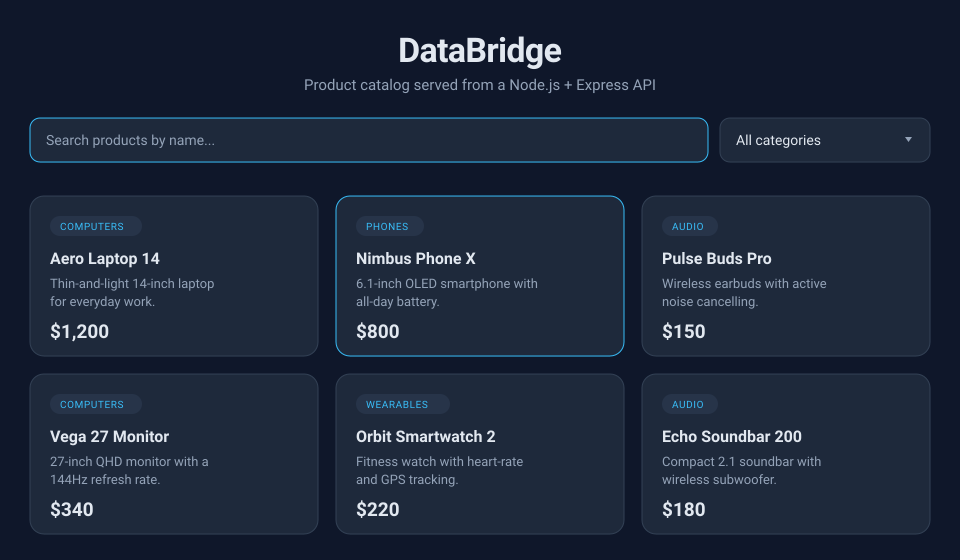

# DataBridge — Front-End + Back-End Split Demo

A small web app that demonstrates **client–server architecture**: a Vanilla JS
front-end fetches product data from a Node.js/Express REST API that reads from a
local JSON file.

## Example screen

The front-end renders the API response as a responsive, dark-themed card grid
with live search and a category filter:



> The preview above mirrors the live UI (`frontend/`) and its design tokens. Run
> the app (see [Run it](#run-it)) to interact with search, filtering, and the
> loading/error states.

## Architecture

```
Browser (frontend/)              Server (backend/)
  index.html  --fetch()-->  GET /api/items  -->  data/items.json
  script.js   <--JSON-----  Express + CORS   <--  (read file)
  style.css
```

## Tech Stack

| Layer    | Tech                    | Why                                 |
| -------- | ----------------------- | ----------------------------------- |
| Frontend | HTML5, CSS3, Vanilla JS | Shows raw fetch() with no framework |
| Backend  | Node.js, Express        | Fast, standard REST API setup       |
| Data     | `data/items.json`       | Simulates a DB without the overhead |

## Project Structure

```
databridge/
├── backend/
│   ├── server.js          # Express app, CORS, error handling
│   ├── routes/items.js    # GET /api/items (+ optional filters)
│   ├── data/items.json    # Product catalog (mock DB)
│   └── package.json
├── frontend/
│   ├── index.html         # Markup + search/filter controls
│   ├── style.css          # Responsive card grid, spinner
│   └── script.js          # fetch(), render, loading/error states
└── README.md
```

## Run it

```bash
# 1. Start the backend
cd backend
npm install
npm start            # API on http://localhost:5000

# 2. Serve the frontend (separate terminal)
cd frontend
npx serve .          # or: python3 -m http.server 5500
# then open the printed URL in a browser
```

> Open the frontend through a local server (not `file://`) so `fetch()` works
> against `http://localhost:5000`.

## API

`GET /api/items` — returns the full product list as JSON.

Optional query params (also filterable client-side):

| Param      | Example                     | Effect                        |
| ---------- | --------------------------- | ----------------------------- |
| `category` | `/api/items?category=Audio` | Filter by category            |
| `search`   | `/api/items?search=phone`   | Filter by name (case-insens.) |

Sample response:

```json
[
  { "id": 1, "name": "Aero Laptop 14", "price": 1200, "category": "Computers" }
]
```

## Features

- Responsive card grid (mobile + desktop)
- Loading spinner while fetching
- Error state when the API is unreachable
- Live search box (filters by name)
- Category filter
- Hover micro-interaction on cards

## SDLC mapping

Planning -> Requirements (fetch + display + handle errors) -> Design (this README)
-> Implementation (backend first, then frontend) -> Testing (API returns JSON, UI
renders, errors handled) -> Deployment (frontend: Netlify/Vercel, backend:
Render/Railway).

## License

Released under the [MIT License](LICENSE).

## Verification and classroom walkthrough

Use Node.js 22 or newer. Install reproducible dependencies with `npm ci` in
`backend/`, then run `npm test`. The tests use Node's built-in test runner and
make real HTTP requests on a temporary port. They cover combined filters, empty
results, CORS, invalid repeated/nested query parameters (400), unknown routes
(404), and invalid catalog data (500). The storage failure test briefly replaces
`data/items.json` and restores its original contents in `finally`; run tests
separately from a live classroom server. Frontend tests exercise rendering,
filtering, network/HTTP/payload errors, and retry using a small DOM test double.

For the live lesson:

1. Start the API with `npm start` in `backend/`.
2. In `frontend/`, run `python -m http.server 5500` and open
   `http://localhost:5500` (Python is only the static file server).
3. Open browser Developer Tools, select Network, and reload. Inspect the
   `GET http://localhost:5000/api/items` request and its JSON response.
4. Search for `Pulse` and select Audio. Filtering occurs in the browser after
   the initial request; demonstrate server filtering separately by opening
   `http://localhost:5000/api/items?category=Audio&search=Pulse`.
5. Search for a nonexistent name to show the empty state. Stop the API and
   reload to show the error panel. Restart it and choose Retry to recover.
6. Resize to 320px and a desktop width to inspect the responsive card grid.

The frontend waits up to 10 seconds for the API, validates the response shape,
and inserts product values as text. The backend validates query types and
catalog structure, forwards storage/JSON failures to its generic JSON 500
handler, and never sends filesystem details to the client. The API URL is the
`API_URL` constant at the start of `frontend/script.js`; update it if changing
the backend port. Cross-origin access is open for this local, read-only demo.

Automated frontend tests do not measure browser layout. The resize and Network
steps above are manual browser checks for the classroom presenter.

## Test evidence

[Word test report](docs/Test%20Evidence.docx) contains captioned screenshots of
all three automated test results and the syntax/whitespace checks. Original PNG
screenshots, captured text logs, and HTML transcript views are preserved in
`docs/test-evidence/`. These are screenshots of actual recorded command output.
The report also identifies browser layout and accessibility checks that remain
manual. Its two pages were rendered with Microsoft Word and visually reviewed.
